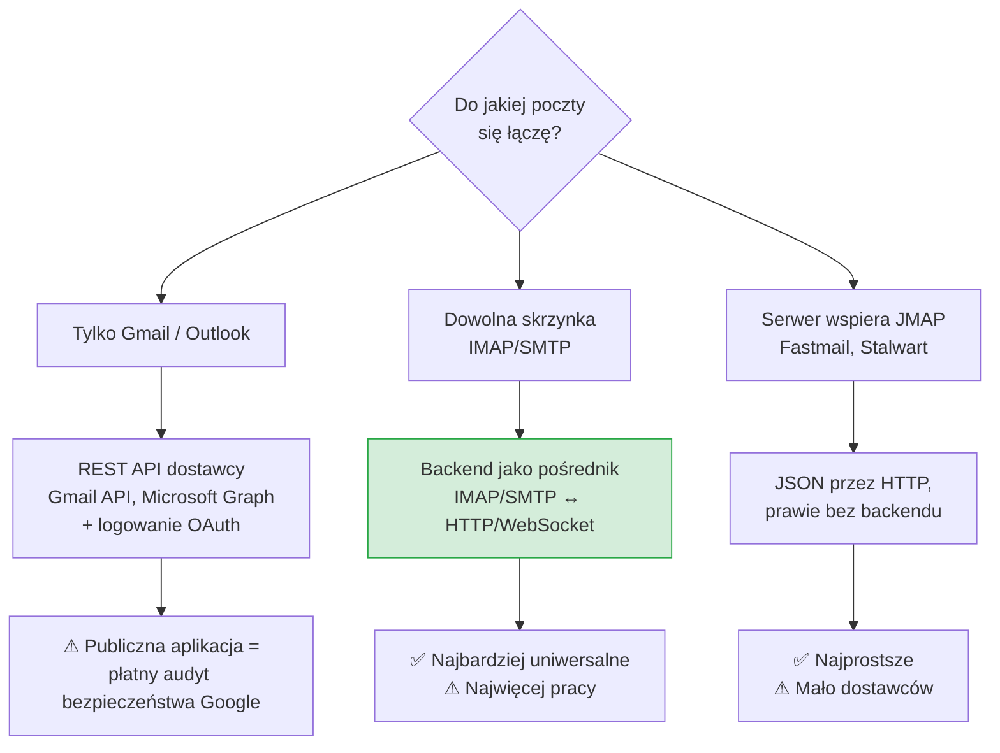
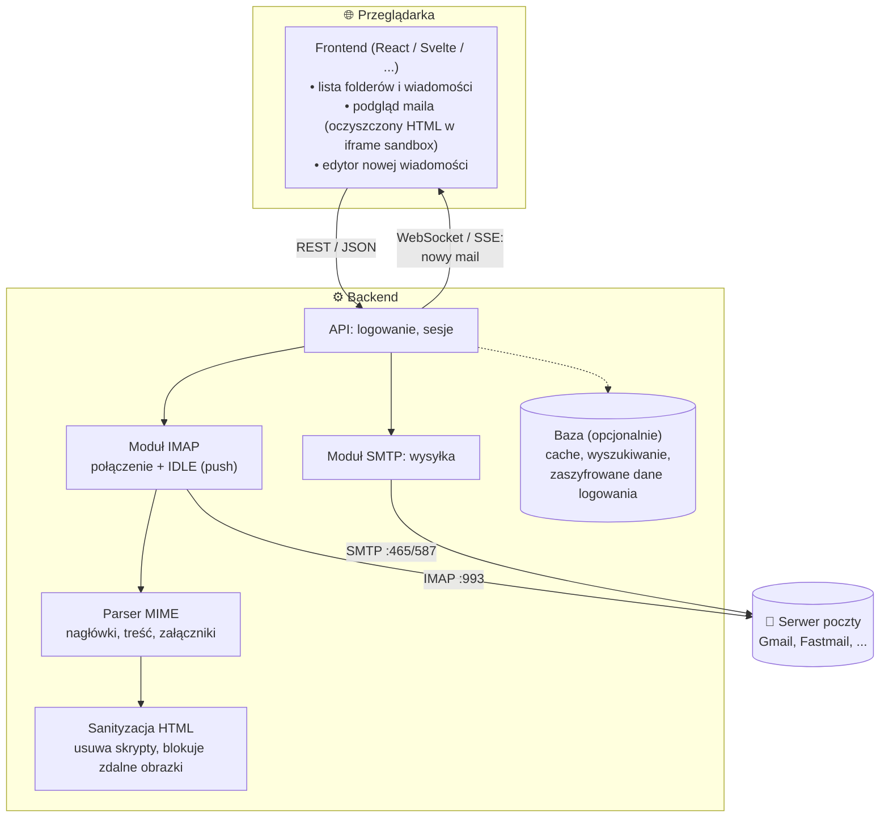
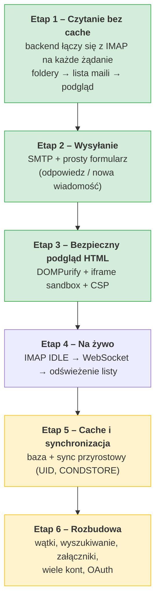
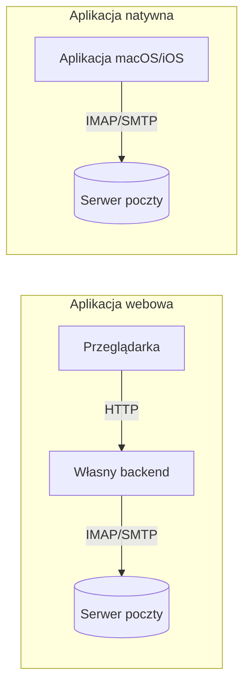
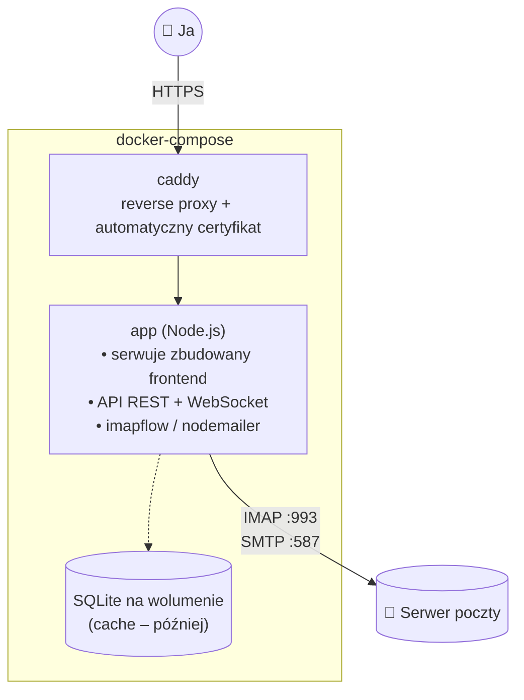

# Listonox – architektura minimalistycznego klienta e-mail

Notatki projektowe: jak podejść do budowy własnego klienta poczty jako aplikacji webowej, czym różni się wariant natywny (macOS/iOS) i jak to wdrożyć w Dockerze.

## Spis treści

1. [Najważniejsze ograniczenie](#1-najważniejsze-ograniczenie)
2. [Wybór sposobu dostępu do poczty](#2-wybór-sposobu-dostępu-do-poczty)
3. [Architektura aplikacji webowej](#3-architektura-aplikacji-webowej)
4. [Plan budowy etapami](#4-plan-budowy-etapami)
5. [Gdzie naprawdę jest trudno](#5-gdzie-naprawdę-jest-trudno)
6. [Web app czy natywna aplikacja na Maca/iOS?](#6-web-app-czy-natywna-aplikacja-na-macaios)
7. [Wdrożenie w Dockerze](#7-wdrożenie-w-dockerze)
8. [Proponowany stos technologiczny](#8-proponowany-stos-technologiczny)

---

## 1. Najważniejsze ograniczenie

**Przeglądarka nie potrafi rozmawiać z serwerem poczty bezpośrednio.**

Protokoły pocztowe:

- **IMAP** (odbieranie, port 993) i **SMTP** (wysyłanie, port 465/587) działają na surowych połączeniach TCP.
- Przeglądarka zna tylko **HTTP** i **WebSocket**.

Dlatego aplikacja webowa prawie zawsze potrzebuje **własnego backendu**, który tłumaczy jedno na drugie. To główna decyzja architektoniczna i reszta z niej wynika.

Klient poczty jest naprawdę trudny dopiero wtedy, gdy chce się zbudować „drugiego Gmaila”. Wersja minimalistyczna to rozsądny projekt.

---

## 2. Wybór sposobu dostępu do poczty

**Rekomendacja dla MVP:** IMAP/SMTP przez własny backend, na początek **jedno konto (moje)**. Działa z każdą skrzynką, a hasło aplikacji (app password) wystarczy zamiast OAuth.

---

## 3. Architektura aplikacji webowej

### Za co odpowiada każda warstwa

| Warstwa | Odpowiedzialność |
|---|---|
| **Frontend** | Interfejs: foldery, lista wiadomości, podgląd, edytor. Bez logiki protokołów pocztowych. |
| **API** | Uwierzytelnienie użytkownika aplikacji, endpointy REST, kanał WebSocket/SSE do powiadomień. |
| **Moduł IMAP** | Utrzymuje połączenie z serwerem, pobiera foldery i wiadomości, nasłuchuje przez `IDLE`. |
| **Parser MIME** | Zamienia surowy mail na nagłówki, treść tekstową/HTML i załączniki, obsługuje kodowania. |
| **Sanityzacja** | Mail to treść od obcych osób: usuwa skrypty, blokuje piksele śledzące i zdalne obrazki. |
| **Moduł SMTP** | Wysyła wiadomości. |
| **Baza** | Opcjonalna na start. Później cache nagłówków, wyszukiwanie, przechowywanie kont. |

---

## 4. Plan budowy etapami

Każdy etap daje działającą aplikację. Nie trzeba robić wszystkiego naraz.

- 🟢 **Etapy 1–3**: kilka weekendów pracy, daje używalnego klienta.
- 🟡 **Etapy 5–6**: tu zaczynają się prawdziwe trudności. Do tego momentu będzie już wiadomo, czy są potrzebne.

---

## 5. Gdzie naprawdę jest trudno

| Obszar | Dlaczego boli | Jak to obejść |
|---|---|---|
| **Parsowanie MIME** | Kodowania, zagnieżdżone części, nietypowe maile | Gotowa biblioteka (`postal-mime`, `mailparser`). Nie pisać własnego parsera. |
| **Bezpieczeństwo HTML** | Treść od obcych osób, czyli ryzyko XSS i pikseli śledzących | Sanityzacja, `<iframe sandbox>`, domyślnie blokowane zdalne obrazki, nagłówki CSP |
| **Synchronizacja** | Rozjazd stanu serwera i lokalnego cache, zmiana `UIDVALIDITY` | Na start nie robić cache (odłożone do etapu 5) |
| **Dane logowania** | Hasła do skrzynek przechowywane na serwerze | Wersja dla jednego użytkownika, hasła aplikacji, szyfrowanie, później OAuth |
| **Gmail OAuth (publicznie)** | Dostęp do poczty to „restricted scope” i wymaga płatnego audytu | Do użytku prywatnego wystarczy IMAP + hasło aplikacji |

---

## 6. Web app czy natywna aplikacja na Maca/iOS?

Natywna aplikacja **może otworzyć połączenie TCP**, więc łączy się z IMAP/SMTP bezpośrednio i nie potrzebuje pośrednika.

### Zalety wersji natywnej

- Nie ma serwera do utrzymania.
- Hasła są w **Keychain** na urządzeniu, a nie w bazie na serwerze.
- Na **macOS** aplikacja może trzymać `IDLE` otwarte cały czas, więc nowe maile pojawiają się od razu.

### Wady i ograniczenia

- **iOS w tle:** system usypia aplikację, więc nie utrzyma połączenia `IDLE`. Natychmiastowe powiadomienia wymagają serwera, który pilnuje skrzynki i wysyła push przez **APNs**. Backend wraca tylnymi drzwiami. Bez niego zostaje odświeżanie po otwarciu aplikacji i okazjonalne pobieranie w tle.
- **Słabsze biblioteki:** w Swifcie nie ma odpowiednika `imapflow`.
  - `MailCore2`: dojrzały, ale stary (C++/Obj-C),
  - `swift-nio-imap` od Apple: nowoczesny, ale niskopoziomowy.
  - Parsowanie MIME też jest uboższe.
- **Dystrybucja:** konto deweloperskie Apple (99 USD rocznie), App Store review i dwie platformy UI, nawet jeśli SwiftUI wiele z tego wspólnie obsłuży.
- **HTML maili** i tak trzeba renderować w `WKWebView`, więc problemy bezpieczeństwa są te same.

### Werdykt

| Kryterium | Web app (Docker) | Natywna Mac/iOS |
|---|---|---|
| Połączenie z pocztą | przez backend | bezpośrednio ✅ |
| Dostęp z każdego urządzenia | ✅ | tylko Apple |
| Powiadomienia na iOS | Web Push (PWA) | wymaga serwera + APNs |
| Dojrzałość bibliotek | ✅ (Node.js) | słabsza |
| Utrzymanie | serwer/VPS | App Store, konto deweloperskie |

Natywnie znika problem pośrednika, ale dochodzą ograniczenia platformy i słabsze narzędzia. **Dla jednej osoby, która chce mieć dostęp z każdego urządzenia, web app w Dockerze jest prostszy w całości.**

---

## 7. Wdrożenie w Dockerze

Najlepsza wersja na początek to **self-hosted dla jednego użytkownika**. Wtedy większość problemów z bezpieczeństwem znika, bo aplikacja nie przechowuje cudzych haseł.

### Na co uważać

1. **Proces musi działać stale.** `IDLE` to długo otwarte połączenie, więc potrzebny jest zwykły kontener na VPS lub w domu. Platformy serverless (Vercel, AWS Lambda) się do tego nie nadają.
2. **Wystarczy jeden kontener aplikacji.** Backend może serwować zbudowany frontend, więc osobny kontener na frontend to zbędna komplikacja na start.
3. **HTTPS jest obowiązkowy**, bo przez połączenie idą dane logowania i treść maili. Caddy załatwia to jedną linijką konfiguracji.
4. **Dane logowania** przekazywać przez zmienne środowiskowe albo Docker secrets i nie trzymać ich w repozytorium. Do Gmaila użyć hasła aplikacji.
5. **Logowanie do samej aplikacji:** przy wystawieniu do internetu dodać własne hasło albo schować aplikację za **Tailscale** lub **Cloudflare Access**. To najprostsze i bardzo bezpieczne.
6. **Porty wychodzące:** niektórzy dostawcy VPS blokują port 25, ale klient używa 587 lub 465, więc zwykle nie ma problemu.

---

## 8. Proponowany stos technologiczny

| Element | Wybór | Uwagi |
|---|---|---|
| Backend | **Node.js** (TypeScript) | najlepszy ekosystem bibliotek pocztowych |
| IMAP | [`imapflow`](https://github.com/postalsys/imapflow) | nowoczesne API, obsługa `IDLE` i `CONDSTORE` |
| SMTP | [`nodemailer`](https://nodemailer.com/) | standard de facto |
| Parsowanie MIME | [`postal-mime`](https://github.com/postalsys/postal-mime) | lekki, działa też w przeglądarce |
| Sanityzacja HTML | [`DOMPurify`](https://github.com/cure53/DOMPurify) | + `<iframe sandbox>` + CSP |
| Frontend | React lub Svelte | dowolny, byle prosty |
| Baza (później) | SQLite | wystarczy dla jednego użytkownika |
| Reverse proxy | Caddy | automatyczny HTTPS |
| Dostęp zdalny | Tailscale / Cloudflare Access | bez wystawiania aplikacji publicznie |

---

### Następny krok

Szkielet projektu dla **etapu 1**: `docker-compose.yml`, backend z `imapflow` (lista folderów i maili) oraz prosty frontend.
